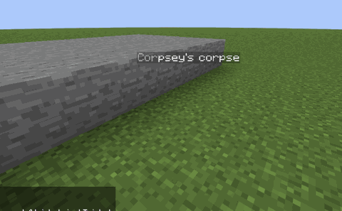
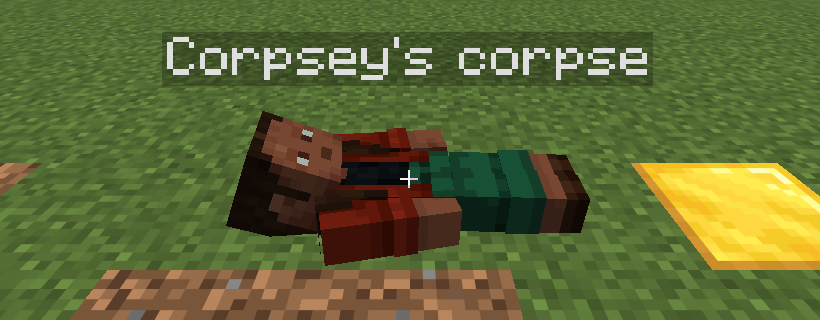
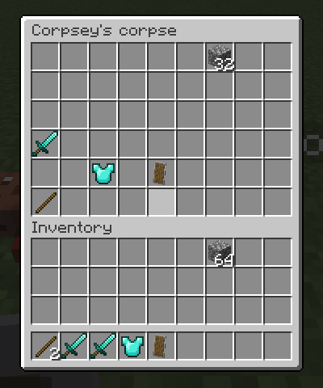

# Last Rites

<a href='https://fabricmc.net'></a>

When you die, your items stay on your corpse instead of spilling on the ground.

Last Rites is a fork of [Reliable Requiem](https://github.com/evanbones/Reliable-Requiem) by Evan, itself a rewrite of
[Corpse Complex](https://modrinth.com/mod/corpse-complex). It keeps all of Reliable Requiem's configurable death
penalties and adds corpses. It targets **Minecraft 26.3 on Fabric** only.





## Corpses

* **Where you fell:** whatever Reliable Requiem doesn't let you keep goes into a corpse wearing your skin, lying
  centered on the spot where you died (turned aside if a wall is in the way). Your dropped experience goes into it too.
* **Ragdoll:** the body collapses with physics and settles over the ground it lands on (slumped against a wall, draped
  over a step), with ashen, greyed skin. Everyone sees the same pose; players who arrive later see it already lying still.
* **Right-click** to open it. Items are laid out like your inventory: main rows, hotbar, armor and offhand, then
  accessories on the bottom row.
* **Sneak + right-click** puts everything back into the slot it came from, including armor and
  [Trinkets](https://modrinth.com/mod/trinkets-updated) slots. Anything that doesn't fit goes into your inventory, or
  drops if that's full.
* **Safe:** corpses can't be hurt, pushed or burned and never despawn. They float where you died (in water, in the air).
  Die in the void and the corpse lies on the top block of that column instead. An empty corpse disappears.
* **Locked to you** for 30 minutes of game time, then anyone can open it. Server operators can always open corpses.
* Corpses are vanilla mannequins plus a vanilla interaction entity over the body (so it's easy to click, and the name
  floats over the middle). The ragdoll and ashen skin are drawn by the mod on the client.
* If a corpse is killed anyway (a creative player, `/kill`), it drops everything it holds.



## Death penalties (from Reliable Requiem)

### Inventory Control

You can configure percentage chances to keep items in specific inventory sections (Hotbar, Armor, Offhand, and Main
Inventory).

* **Durability Penalty:** Apply a configurable percentage of durability loss to items that are kept through death, with
  an optional minimum durability percentage and a toggle to prevent kept items from breaking.
* **Item Overrides:** Specify exact items to always keep, always drop, or be completely destroyed on death.
* **Tag Support:** Built-in support for the `c:soulbound` enchantment tag and an additional
  `reliable_requiem:retained_on_death` item tag to retain specific items.

### Death Drops

Tired of losing your items to creepers or the despawn timer?

* **Protected Drops:** Make your death drops immune to explosions and prevent them from ever despawning.
* **Item Spread Multiplier:** Adjust the velocity and spread of dropped items and experience orbs on death.

### Respawning

Customize the exact state the player is in when they return to life:

* **Hunger & Saturation:** Choose to keep your food and saturation levels, or enforce minimum and maximum food caps upon
  respawning.
* **Health Reduction on Death:** Configurable maximum health loss upon death down to a set minimum limit to encourage a
  more cautious playstyle.
* **Crystals & Shards:** Breaking Mob Spawners drops **Crystal Shards**. Surround a Ghast Tear with 8 shards to craft
  a **Heart Crystal**, which permanently increases max health by +1 heart when used, up to a configurable maximum limit.
* **Stamina Crystals (Modest Meals):** With Modest Meals installed, surround Redstone with 8 shards to craft a
  **Stamina Crystal**, which permanently increases max stamina by +1 bolt. Max stamina carries over through death and
  can optionally be reduced on death, just like max health.
* **Health Scaling:** Respawn with a percentage of your maximum health or set a hard cap on respawn health.
* **Status Effects:** Configurable options to let positive or negative potion effects persist through death.
* **Experience Tweaks:** Control the exact percentage of XP lost, how much drops per level, and the maximum dropped XP.
* **Randomized Respawn:** Add a configurable random radius to your respawn location to make getting back to your base a
  bit more challenging.

### Memento Mori

An optional, custom post-death debuff. When enabled, players respawn with the **Memento Mori** effect, which temporarily
reduces movement speed and attack damage. The duration and severity of the debuff are configurable.

### Quality of Life Tweaks

* **Death Coordinates:** Optionally display your exact death coordinates directly on the death screen.
* **Bypass Rules:** Disable keep-inventory tweaks entirely for specific dimensions or specific damage sources.

## Configuration

Settings live in `config/last_rites.json`. With [YACL](https://modrinth.com/mod/yacl) installed you can also change
them in-game. Corpse settings:

| Setting | Default | |
| --- | --- | --- |
| `corpsesEnabled` | `true` | Off: death drops behave exactly like Reliable Requiem. |
| `corpseLockSeconds` | `1800` | Game-time seconds only the owner can open a corpse. `0` = anyone right away, `-1` = owner only, forever. |
| `corpseOpsBypassLock` | `true` | Operators can open any corpse. |

With `keepInventory` on there's nothing to drop, so no corpse is made.

## Credits

Thanks to the excellent [Matcha Flavoured](https://modrinth.com/datapack/matcha-flavoured) datapack for the Crystal
Heart idea and assets. Licensed under [CC BY-NC-SA 4.0](https://creativecommons.org/licenses/by-nc-sa/4.0/).

## Differences from Reliable Requiem

* Adds corpses (above).
* Mod id `last_rites`, config file `config/last_rites.json`. Items and effects keep the `reliable_requiem:` ids, so a world
  that used Reliable Requiem keeps them. Don't install both.
* Builds only the 26.3 Fabric target.

## Building

```sh
./gradlew :26.3-fabric:build
# -> versions/26.3-fabric/build/libs/last_rites-<version>+26.3-fabric.jar
```

## License

GPL-3.0, like Reliable Requiem. See [LICENSE](LICENSE).
